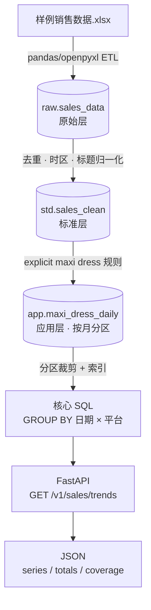
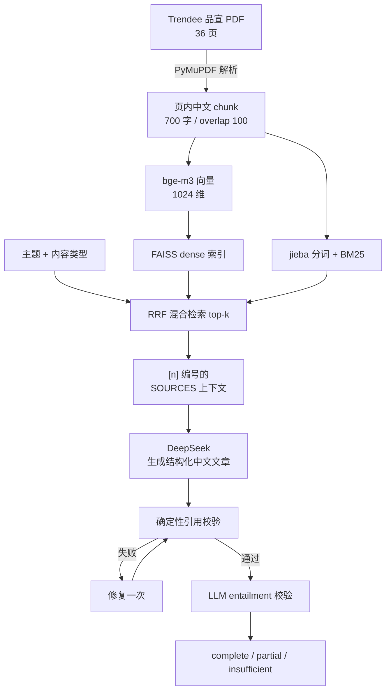

# 万悉科技 AI 数据工程师笔试题 · 解决方案概览

> 两个项目均为可运行 Demo，代码托管于 GitHub 仓库 `geo_data_rag_task`。

## 任务一 · 销售数据查询与 API 设计（sales-trend/）

基于 PostgreSQL 三层模型 + FastAPI，实现 maxi dress 日销量趋势查询 API。

关键设计：

| 点 | 说明 |
|---|---|
| maxi dress 口径 | explicit-only：`category=dress` 且标题归一化后同时含 `maxi`、`dress` |
| 三层模型 | 原始层 → 标准层 → 应用层；应用层按月分区、复合主键索引 |
| 幂等 ETL | 300 原始行 → 288 去重后 → 119 条 maxi，销量 1117；重复执行不重复计数 |
| 高并发 | 应用层预聚合、分区裁剪、`psycopg_pool` 连接池、coverage 预计算 |
| 范围保护 | day/week/month 按返回点数保护（`MAX_SERIES_POINTS`），超限 422 |
| 错误处理 | 统一错误 envelope（400 / 422 / 503） |

技术栈：PostgreSQL 16 · FastAPI · Pydantic · psycopg3/pool · pandas/openpyxl · Docker Compose

## 任务二 · RAG 品牌内容写作（rag/）

基于 Trendee 品宣 PDF 的检索增强写作：混合检索 + LLM 生成 + 双层引用校验，事实可回溯到 PDF 页码。

关键设计：

| 点 | 说明 |
|---|---|
| 检索 | bge-m3 dense + BM25 sparse，RRF 融合，相关度地板 + 每页上限 |
| 事实可追溯 | 每个事实性段落带 `[n]` 引用，来源卡片含 PDF 页码、section、原文片段 |
| 幻觉控制 | 确定性引用检查（编号/覆盖/数字/否定）+ entailment 校验，fail-closed |
| 拒答 | 无证据返回 `insufficient`，不调用 LLM，不编造 |
| 内容类型 | Blog / FAQ / 品牌介绍 / 产品介绍，均含标题、导语、小标题、结论 |
| 安全 | 密钥只放本地 `.env`；来源文本视为不可信数据（防提示注入） |

技术栈：Python · Streamlit · PyMuPDF · bge-m3 · FAISS · BM25 · DeepSeek · jieba

## 交付与验证

| 项目 | 自动化测试 | 运行方式 | 真实证据 |
|---|---|---|---|
| sales-trend | 40 passed | `docker compose up --build -d` | API 返回 total_sales=42 / 1117 |
| rag | 88 passed | `streamlit run app.py` | 真实生成 complete（10/10 supported） |

详见各项目 `README.md` 与 `docs/`。
